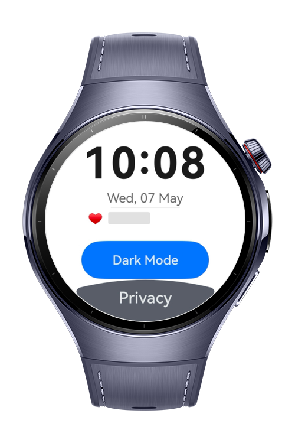
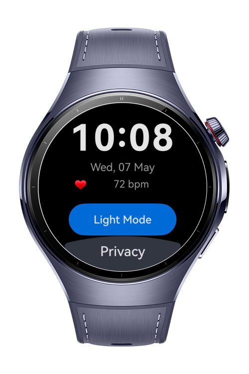

> **Note:** To access all shared projects, get information about environment setup, and view other guides, please visit [Explore-In-HMOS-Wearable Index](https://github.com/Explore-In-HMOS-Wearable/hmos-index).

# How to Build Theme Dark Mode

A dynamic theming and dark mode engine for HarmonyOS wearables, optimised for AMOLED displays. The app demonstrates a watch face that switches between Light and Dark themes at runtime, applies a pure-black dark palette to power off OLED pixels, obscures sensitive health data in Privacy Mode, and renders a semi-transparent control panel with state-aware interactive buttons.

# Preview

<div>
  
  
  
</div>

# Use Cases

- **AMOLED Dark Mode** — Switch to a pure-black (`#FF000000`) background so the display powers off individual pixels, saving meaningful battery on OLED wearable screens.
- **Runtime Theme Switching** — Toggle between Light and Dark presets; all child components re-render automatically through `WithTheme` with no manual attribute reassignment.
- **Privacy Overlay** — Blur sensitive heart-rate data on demand with `obscured([ObscuredReasons.PLACEHOLDER])`, simulating a wrist-down or screen-lock privacy event.
- **State-Aware Buttons** — The theme toggle demonstrates `normal`, `pressed`, and `disabled` interaction states through `stateStyles` (Polymorphic Style).
- **Wearable-Native ArcButton** — The privacy toggle uses `ArcButton` with `BOTTOM_EDGE` positioning, anchored to the bottom arc of the circular display.

# Tech Stack

- **Languages**: ArkTS
- **Frameworks**: HarmonyOS SDK (API 20+)
- **Tools**: DevEco Studio 5.x
- **Libraries & Kits**:
    - `@kit.ArkUI`

**Target APIs**

| Module | API Used |
|---|---|
| Colors | `Colors` interface (`brand`, `fontPrimary`, `fontSecondary`, `backgroundPrimary`) |
| CustomDarkColors | `type CustomDarkColors = Partial<Colors>` |
| Theme | `Theme` object via `onWillApplyTheme(theme: Theme)` |
| Themes (CustomTheme) | `CustomTheme` interface + `ThemeControl.setDefaultTheme()` |
| Custom Font Styles | `@font-face` declaration + `fontFamily('WatchFont')` |
| Polymorphic Style | `.stateStyles({ normal, pressed, disabled })` |
| Opacity Control | `.opacity(0.85)` |
| Obscuring | `.obscured([ObscuredReasons.PLACEHOLDER])` |

# Directory Structure

```
entry/src/main/
├── ets/
│   ├── pages/
│   │   └── Index.ets                  // Entry page; RelativeContainer layout, WithTheme scope, state management
│   ├── theme/
│   │   └── AppThemes.ets              // LightColors, DarkColors, LightTheme, DarkTheme definitions
│   └── components/
│       ├── WatchFace.ets              // Clock, date, heart rate; onWillApplyTheme; obscured toggle
│       └── ControlPanel.ets           // Theme toggle (stateStyles); ArcButton privacy toggle; opacity overlay
└── resources/
    ├── base/
    │   └── element/
    │       ├── color.json             // Light mode color tokens (17 tokens)
    │       └── string.json            // All UI strings
    ├── dark/
    │   └── element/
    │       └── color.json             // Dark mode color overrides
    └── rawfile/
        ├── WatchFont.ttf              // Custom wearable typeface (add your own .ttf)
        └── font.css                   // @font-face declaration
```

# Constraints and Restrictions

## Supported Devices

- Huawei Watch 5 

# License

**How to Build Theme Dark Mode** is distributed under the terms of the MIT License.
See the [LICENSE](./LICENSE) for more information.